# musicsearch

A music search app built for the Moises Android code challenge. It searches the iTunes catalog,
plays 30-second previews, and keeps working offline. On top of the required phone app, the same
code runs on **iOS**, in **Android Auto**, and as a standalone **Wear OS** app.

Built with Kotlin Multiplatform, Compose Multiplatform, MVI, Room, Paging 3, Ktor, Koin and Media3.

## Features

**Required by the challenge**

- **Splash** with the app logo (SplashScreen API on Android, LaunchScreen on iOS).
- **Songs (Home):** search with debounce and infinite scrolling, pull to refresh, and the
  recently played list when the search is empty.
- **Player:** artwork, title, artist, a seekable timeline, play/pause, previous/next and repeat
  (off, one, all). Playback continues in the background with the system media notification.
  Opening the song that is already playing jumps to the player at the current position instead
  of starting it over.
- **More options:** a bottom sheet from any song row or from the player, with "View album".
- **Album:** cover, title, artist and the full track list in disc order. Tapping a track plays the album from there.
- **Offline-first:** results come from a local database. Earlier searches, recently played songs and
  visited albums still open with no network, and an offline banner offers a retry.

**Extras**

- **Shared-element transition:** the song cover grows from the list row into the player and back.
  Screen transitions are short (300 ms in, 200 ms out) so navigation feels direct.
- **Mini player:** back on Songs, a floating bar shows the current song with play/pause and opens
  the player when tapped.
- **Sound wave page:** swipe the player cover sideways to see an animated wave in the colors of the
  album art. The wave is drawn from the playback state, not from the audio itself, and gray covers
  fall back to a green palette.
- **Accessibility:** headings, state descriptions ("Now playing", "No preview"), labelled
  controls, a timeline that reads as "0:12 of 0:30", and live announcements for empty, error and
  offline states.
- **Android Auto:** "Recently played" and "Last search" tabs, voice search, and the queue. Tabs refresh as you play and search.
- **Wear OS:** a standalone watch app with search (keyboard or voice), a player with a progress
  ring, recently played albums and their tracks.
- **iOS:** the same screens and logic, with AVPlayer and the iOS Now Playing controls.

## Demo

Screenshots from the Android emulator, a Wear OS emulator and the Android Auto Desktop Head
Unit. All of them are in [`docs/demo/screenshots/`](docs/demo/screenshots).

**Phone**

| Empty home | Search | Player | More options |
|---|---|---|---|
| 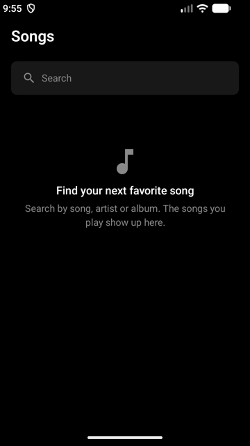 | 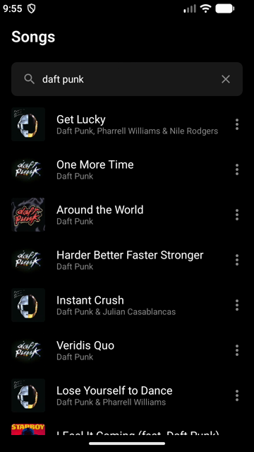 | 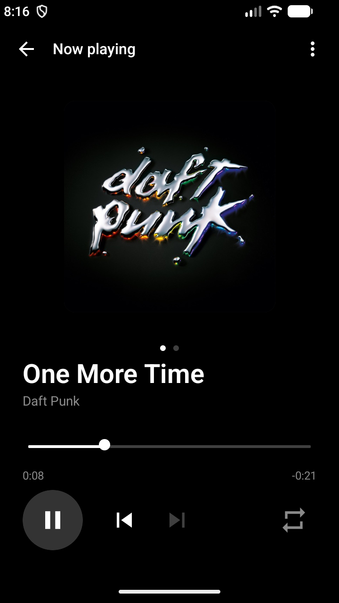 | 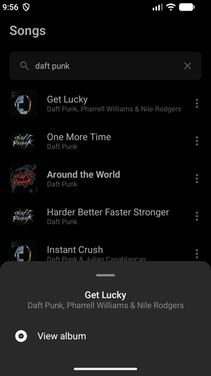 |

| Sound wave | Mini player | Album | Recently played |
|---|---|---|---|
| 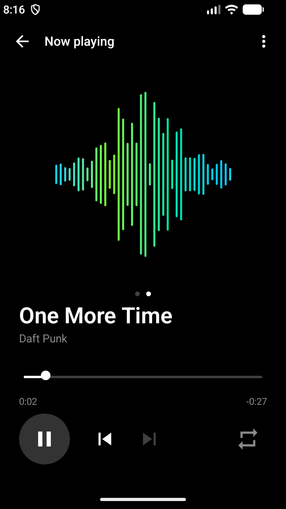 | 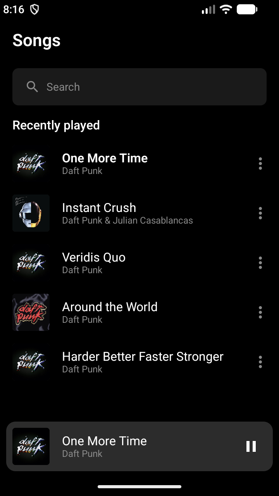 | 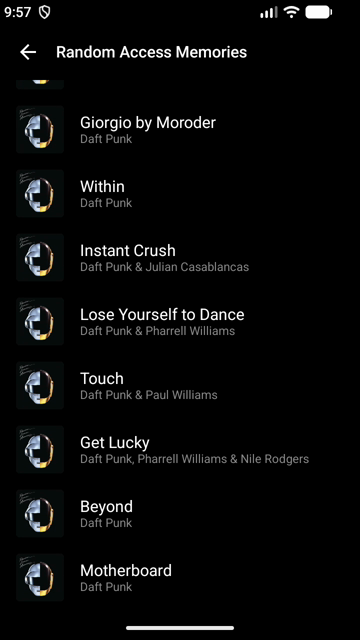 | 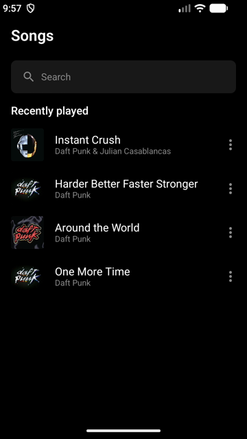 |

| Offline |
|---|
| 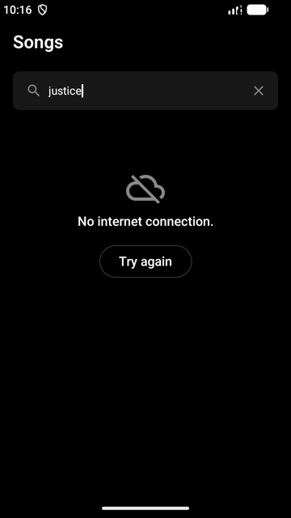 |

**Wear OS**

| Menu | Search results | Player |
|---|---|---|
| 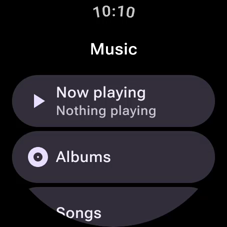 | 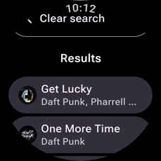 | 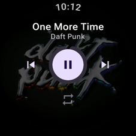 |

**Android Auto**

| Recently played | Last search |
|---|---|
| 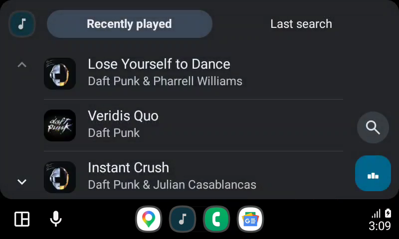 | 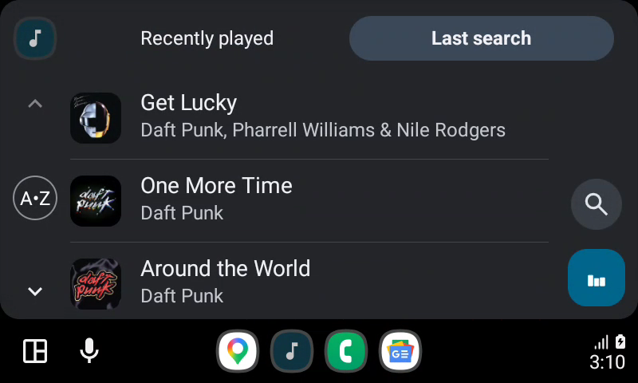 |
| **Now playing** | **Queue** |
| 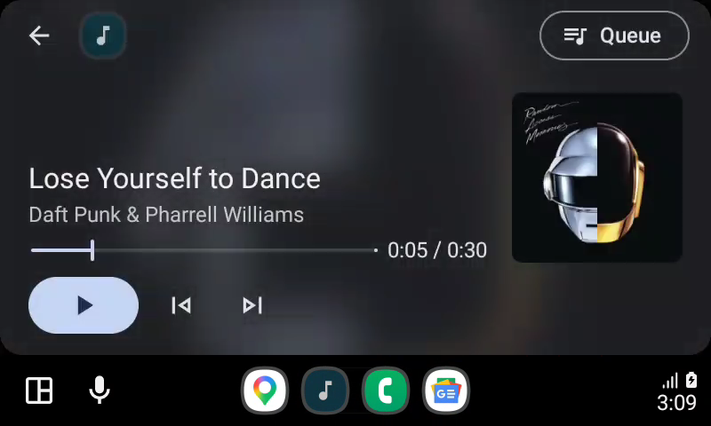 | 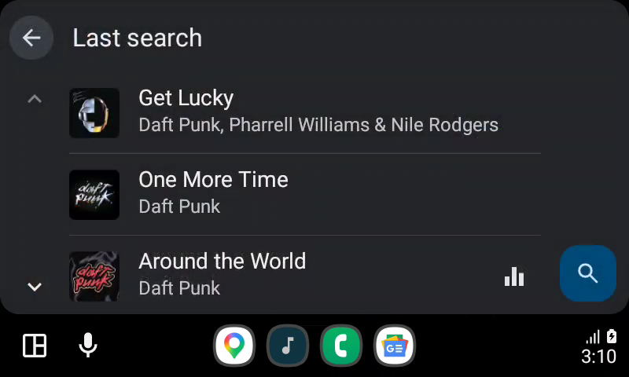 |

## Architecture

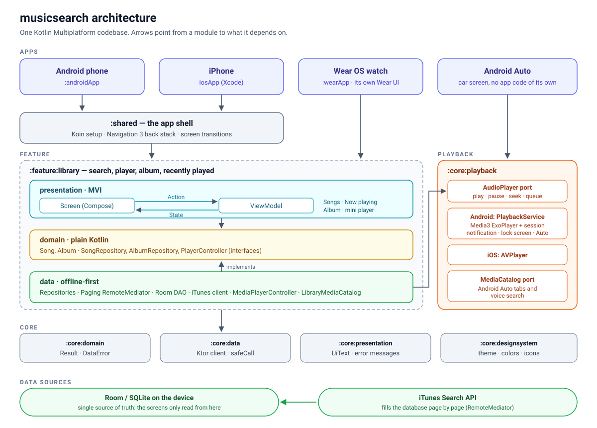

How to read it, top to bottom:

1. **Apps** are thin. The phone and iPhone apps only start `:shared`. The watch has its own Wear
   UI on top of the same feature code. Android Auto has no code of its own: it talks to the
   playback service.
2. **`:shared`** builds the dependency graph (Koin) and the navigation back stack.
3. **`:feature:library`** holds the product, split in three layers. Presentation depends on domain,
   data implements domain, and domain depends on nothing.
4. **`:core:*`** holds what any feature can reuse: the `Result` type, the HTTP client, error
   messages, the design system and the player.
5. **Data sources:** the screens only read Room. The iTunes API writes into Room, never straight
   to the screen.

- **MVI** in the presentation layer: each screen has one immutable `State`, a sealed `Action`
  as the only input, and a `Root`/`Screen` split so screens render without a ViewModel.
- **Offline-first data:** Room is the single source of truth. A Paging `RemoteMediator` fills it
  from the iTunes API. A search done less than an hour ago opens from the cache with no request.
- **One player:** a Media3 `MediaLibraryService` owns the ExoPlayer. The app, the notification and
  Android Auto all connect to it, so they always agree on what is playing. Shared code only sees
  an `AudioPlayer` port, which iOS implements with AVPlayer.
- **Rules checked by the build:** module dependencies (Gradle), architecture (Konsist tests),
  and formatting (ktlint via Spotless).

More detail:

- [`ARCHITECTURE.md`](ARCHITECTURE.md): modules, layers, error handling, DI, navigation and testing (in Portuguese).
- [`docs/decisions/`](docs/decisions/index.md): the ADRs, the reasoning behind the main choices.
  1. MVI.
  2. KMP and Compose Multiplatform.
  3. The offline-first cache.
  4. The single player service.

## How it was built

The project started from my own Kotlin Multiplatform skeleton: modules, convention plugins,
architecture rules and CI. I built it with Claude Code as a pair programmer, in seven stages. Each
stage ended with the full check suite green and one Conventional Commit per subject.

1. **Base:** rename the skeleton, apply the dark design tokens measured from the Figma design, and replace the sample features with the `library` and `playback` modules.
2. **Data:** the song, album and player contracts, and the offline-first catalog on iTunes and Room.
3. **Songs:** the icon set and the Home screen with search, recents and the options sheet.
4. **Player and album:** the Media3 and AVPlayer players, the Player and Album screens, splash, launcher icon, background audio and image loading.
5. **Android Auto and Wear OS:** browsing and voice search in the car, live refresh of its tabs, and the standalone watch app.
6. **Wrap-up:** accessibility, the shared-element transition, ADRs, this README, CI and the demo recordings.
7. **Player polish:** the mini player, opening the current song without restarting it, faster screen transitions, and the sound wave page.

Each stage shipped with tests for what it built. A stage only counted as done when these passed:

```bash
./gradlew spotlessCheck :konsist:test testAndroidHostTest :androidApp:assembleDebug :wearApp:assembleDebug
./gradlew iosSimulatorArm64Test connectedAndroidDeviceTest
```

Android Auto was checked live on a physical phone with the Desktop Head Unit, and Wear OS on a Wear emulator.

## Patterns and conventions

- **Clean layers per feature:** `domain` (models, repository interfaces), `data` (Room, Ktor,
  repositories) and `presentation` (ViewModels and Compose). Dependency rules between modules are
  enforced by a Gradle convention plugin, so a wrong import fails the build.
- **MVI:** `State` / `Action` / optional `Event`, a `Root` that holds the ViewModel and a
  stateless `Screen` with previews.
- **Ports and adapters:** platform code sits behind small interfaces in `commonMain`
  (`AudioPlayer`, `MediaCatalog`). Media3, AVPlayer and the Android Auto tree are adapters.
- **Typed errors:** a `Result<T, DataError>` wrapper instead of exceptions. Errors become UI text only in the presentation layer.
- **Koin** for DI with one module per layer, and **Navigation 3** with a back stack owned by `:shared` and callbacks per feature.
- **Testing:** hand-written fakes instead of mocks, Turbine for flows, a fake clock, real Compose
  UI tests on a device, and Konsist tests that read the source to enforce naming and layering.
- **Commits:** Conventional Commits in English, one subject per commit.

Code comments and the internal docs (`ARCHITECTURE.md`, `CLAUDE.md`) are in Portuguese, the
skeleton's working language. Names in code, this README and the ADRs are in English.

## Claude Code skills used

Claude Code skills are instruction packs for the agent. This project follows the **PL Coding**
Android/KMP skill set. It is licensed, so it lives only on my machine in `.claude/skills/` and
is not committed. The conventions it defines are written down in [`ARCHITECTURE.md`](ARCHITECTURE.md),
and where `ARCHITECTURE.md` and a skill disagree, `ARCHITECTURE.md` wins.

Some of these shaped the skeleton before the challenge started (MVI, DI, navigation, errors);
the rest were followed while building the features.

| Skill | Used for |
|---|---|
| `kmp-module-structure` | Module layout, convention plugins, Compose Multiplatform setup |
| `android-data-layer` | Data sources, repositories, DTOs, Room entities, the offline-first mediator |
| `android-presentation-mvi` | State / Action / Event, `Root` / `Screen`, `UiText` |
| `android-di-koin`, `android-navigation`, `android-error-handling` | Koin modules, Navigation 3 wiring, the `Result` / `DataError` types |
| `kotlin-coroutines`, `kotlin-flows` | Player state flows, Paging, section-change notifications for Android Auto |
| `android-unit-testing`, `android-integration-testing`, `android-ui-testing` | Fakes and Turbine, in-memory Room and Ktor `MockEngine`, Compose UI tests on a device |
| `android-version-catalog` | Adding libraries and versions to `libs.versions.toml` |
| `architecture-decision-record` | The MADR records in `docs/decisions/` |
| `git-commit` | Atomic Conventional Commits |

## Where to find things

| What | Where |
|---|---|
| Phone app entry point (manifest, splash, icon) | [`androidApp/`](androidApp) |
| Shared app shell: DI setup and navigation | [`shared/`](shared) |
| iOS app (Xcode project) | [`iosApp/`](iosApp) |
| Wear OS app | [`wearApp/`](wearApp) |
| Song search, player, album and recents (domain, data, presentation) | [`feature/library/`](feature/library) |
| Media3 service, Android Auto tree, AVPlayer | [`core/playback/`](core/playback) |
| HTTP client, errors, theme, shared UI helpers | [`core/`](core) |
| Architecture rules as tests | [`konsist/`](konsist) |
| Convention plugins and module rules | [`build-logic/`](build-logic) |
| Architecture guide (Portuguese) | [`ARCHITECTURE.md`](ARCHITECTURE.md) |
| Decision records | [`docs/decisions/`](docs/decisions/index.md) |
| Demo screenshots | [`docs/demo/screenshots/`](docs/demo/screenshots) |
| Architecture diagram | [`docs/architecture.svg`](docs/architecture.svg) |
| CI | [`.github/workflows/ci.yml`](.github/workflows/ci.yml) |
| Agent working rules | [`CLAUDE.md`](CLAUDE.md) |

## Trade-offs and limitations

- **Previews only:** iTunes gives 30-second previews, and they stream. Offline mode covers
  browsing, not playback.
- **Cache growth:** every distinct search is stored. There is no cleanup of old searches yet.
- **Same UI on iOS:** iOS shares the Compose UI instead of using native SwiftUI. This trades a
  native look for one codebase.
- **No phone–watch sync:** the Wear app is standalone. It talks to iTunes directly and does not
  share playback with the phone.
- **Android Auto details:** section titles are English only, and a queue started from search has no title.
- **iOS tests:** there are no iOS UI tests. Shared logic runs on the iOS simulator in tests, but
  screens are tested on Android only.
- **Notification permission:** the app does not ask for the notification permission. On Android 13+, media
  session notifications are exempt and show even when it is denied.

## Requirements

- JDK 21. Gradle downloads it if missing (`gradle/gradle-daemon-jvm.properties`).
- Android SDK with platform 36, set in `local.properties` (`sdk.dir=...`).
- For iOS: macOS with Xcode.

## Running

### Phone (Android)

```bash
./gradlew :androidApp:installDebug
```

Or run the `androidApp` configuration in Android Studio. Requires Android 8.0 (API 26) or newer.

### Wear OS

Create a Wear OS emulator (API 30+) in Android Studio's Device Manager, start it, then run:

```bash
./gradlew :wearApp:installDebug
```

Or run the `wearApp` configuration. The app shows up as "Music Search" on the watch.

### Android Auto

Android Auto needs a phone with the Android Auto app. The emulator's Android Auto is a stub.

1. Install the phone app on the device: `./gradlew :androidApp:installDebug`.
2. On the phone, open **Android Auto settings**, tap **Version** ten times to turn on developer
   mode, then in the ⋮ menu turn on **Unknown sources** and choose **Start head unit server**.
3. Install the Desktop Head Unit from the SDK Manager (SDK Tools → Android Auto Desktop Head Unit
   Emulator), then forward the port and start it:

   ```bash
   adb forward tcp:5277 tcp:5277
   ```

   ```bash
   ~/Library/Android/sdk/extras/google/auto/desktop-head-unit
   ```

4. Open the media apps in the car screen and pick **Music Search**. Play something on the phone
   first to fill "Recently played", or use the search button.

To turn developer mode off afterwards, use ⋮ → **Quit developer mode** in Android Auto settings.

### iOS

Open `iosApp/iosApp.xcodeproj` in Xcode and run the `iosApp` scheme on a simulator. To run on
a device, set your `TEAM_ID` in `iosApp/Configuration/Config.xcconfig`.

## Tests and checks

| What | Command |
|---|---|
| Format, then check | `./gradlew spotlessApply` then `./gradlew spotlessCheck` |
| Architecture rules (Konsist) | `./gradlew :konsist:test` |
| Unit tests (JVM) | `./gradlew testAndroidHostTest` |
| Shared tests on the iOS simulator | `./gradlew iosSimulatorArm64Test` |
| Phone UI and playback service tests (emulator running) | `./gradlew connectedAndroidDeviceTest` |
| Wear UI tests (watch emulator running) | `./gradlew :wearApp:connectedDebugAndroidTest` |

What is tested:

- **ViewModels and repositories:** unit tests with hand-written fakes, Turbine, and a fake clock.
- **Screens:** device tests with the real ViewModel.
- **Media service:** a device test that connects a real `MediaBrowser` to `PlaybackService`.

CI (`.github/workflows/ci.yml`) runs:

- On every push: formatting, Konsist, unit tests, and both Android builds.
- On pull requests: also device tests on an emulator and the iOS tests.
